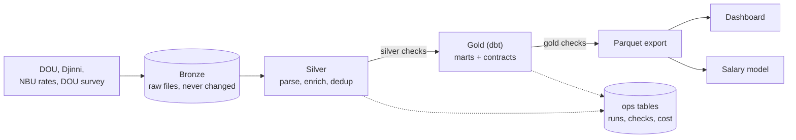

# Dataward: a data pipeline for the Ukrainian IT job market

[](https://github.com/conlusive/Dataward/actions/workflows/ci.yml)
[](https://github.com/conlusive/Dataward/actions/workflows/pipeline-daily.yml)

A reproducible, observable pipeline that scrapes IT vacancies from DOU and Djinni every night into an
immutable bronze layer, cleans and deduplicates them into silver, builds gold marts in dbt, and serves a
dashboard and a salary model on top. **It is not big data** (a few thousand vacancies a day). It is the
engineering practices (idempotent runs, backfill, data contracts, quality checks, observability) applied
to real, messy data, at a size where every result can be inspected.



## The problem

Where is the Ukrainian IT job market moving: which skills are asked for, which go together, what
salaries are stated and for how long a vacancy stays open? The sites show one listing at a time and
keep no history. The answer needs a history, a clean one (the same job is on two sites), and numbers you
can trust. The user is anyone choosing what to learn or what to hire for, and the pipeline's own
operator: the whole point is that the data is dependable.

## The data (honestly)

| | |
|---|---|
| Sources | jobs.dou.ua (16 categories), djinni.co (16 keywords), National Bank exchange rates, the open DOU salary survey (34 waves since 2010) |
| Volume | about 6,900 vacancies on 2026-11-08; about 289,000 survey answers |
| History | since 2026-11-06, so **trends need weeks to mean anything** |
| Not here | work.ua (blocked by a Cloudflare challenge; I do not bypass it), vacancies outside the 16 categories |

The limits (about 12% of vacancies state a salary, the survey is self-reported, skills come from a
dictionary) are in [docs/data_sources.md](docs/data_sources.md). Scraping is polite: `robots.txt`, 1-2
requests per second, an honest User-Agent, no logins. Raw vacancy text is not published.

## Architecture

Medallion layers: **bronze** (raw files, a metadata file written last), **silver** (DuckDB tables written
by Python with upserts), **gold** (dbt models with tests and enforced column contracts), plus **ops**
tables that record every run. A nightly GitHub Actions job runs one flow: scrape, parse, silver checks,
dbt, gold checks, export. A failed step skips the steps that depend on it, so bad data never reaches the
files other people read.

- [docs/architecture.md](docs/architecture.md): the diagram, the layers, how it runs, what it would take at 100x
- [docs/data_model.md](docs/data_model.md) and [docs/lineage.md](docs/lineage.md): every table, and the dbt lineage generated from the project
- [docs/decisions.md](docs/decisions.md): the decisions, why, and what was rejected

## Reliability (the part I care most about)

| Practice | How it is done | Proof |
|---|---|---|
| **Idempotent runs** | deterministic bronze paths, silver upserts that never let an older page overwrite a newer one, gold rebuilt from silver | a test runs a date twice and compares a hash of every silver table and mart |
| **Backfill** | `make backfill FROM TO` re-parses the stored days without the network; the LLM answers come from a cache | tested on a range that includes a day that was never stored |
| **Data contracts** | column types enforced in dbt on every mart and a contract file for silver; the export stops if a table differs | a test fails when the code and the contract drift |
| **Quality checks** | 13 checks with `warn` and `error` levels, thresholds in one file, every result in `ops_dq_results`; an `error` stops the run before the export | each check is tested at its boundaries; a mutated threshold fails a test |
| **SLOs** | data at most 36 h old, 95% of runs succeed in 30 days, under 10% of vacancies without a skill | `jobmarket status` measures them; "not enough data" is shown as such |
| **A real failure** | a hidden employer (`"confidential"`, a string where an object was expected) failed 5 of 5,692 Djinni pages and the whole run | [postmortem](docs/postmortems/2026-11-07-djinni-hidden-employer.md): bronze was already saved, nothing was lost; the run now fails only when more than 5% of a day's pages are unreadable |

Details: [idempotency and backfill](docs/idempotency_and_backfill.md), [data quality](docs/data_quality.md),
[orchestration](docs/orchestration.md).

## Observability

Every flow run is a row (`ops_pipeline_runs`: trigger, link to the Actions run, failed steps). Every step
attempt, scrape, check and LLM call has its own table, so "what happened yesterday and why" is a query.
`jobmarket status` prints the SLOs, recent runs and the checks that need attention; the dashboard's
status page reads the same `status.json`; an optional Telegram message summarises each run (new and
closed vacancies, checks, LLM cost, a link). See [docs/observability.md](docs/observability.md).

## Skill extraction

Two methods find the skills a vacancy asks for (a taxonomy of about 490 skills, see the
[guide](docs/taxonomy_guide.md)):

| Method | Status | On the 150-vacancy gold set (precision / recall / F1) |
|---|---|---|
| Dictionary (trie; "strict" words need an exact spelling and a context word) | running every night; at least one skill in 91% of vacancies (6,282 of 6,911) | 0.74 / 0.91 / 0.81 |
| LLM (Gemini, cached, `--dry-run` first, a cost cap) | run only on the 150 gold vacancies, not on the corpus; about $8 per 10,000 vacancies at list prices (the free tier was used, nothing was billed) | 0.88 / 0.72 / 0.80 |

The dictionary finds more and is wrong more often; the LLM is more careful and misses more (it rarely
names code review, monitoring or DevOps). Neither wins on F1, which is why the dictionary stays the
nightly method and the LLM is a measured option. Details and the most frequent mistakes of each:
[docs/metrics.md](docs/metrics.md).

**How far to trust these numbers.** The gold labels were made by an LLM (Claude), blind to both methods'
answers, and not by a human; the file says so (`labelled_by`). The LLM method is a different model, but
two language models can make the same mistakes, so the real accuracy may differ. 150 vacancies are
enough to see which method is better, not to quote a second decimal. A human check of 15-20 of the
labelled vacancies (`gold-label --relabel`) would settle how far they can be trusted. The labelling also
listed 504 skills the taxonomy lacks (ArduPilot, UART, Clean Architecture, Kotlin Coroutines...), kept in
the gold file as the list of what to add next.

## Consumers

- **Dashboard** (Streamlit, Ukrainian, reads only the exported parquet): market overview, skills, stacks,
  salaries, pipeline status, about the data. [docs/dashboard.md](docs/dashboard.md)
- **Salary model** (CatBoost p10/p50/p90, MLflow): trained on the survey, because only a few hundred
  vacancies state a salary. Judged on the last survey year, which it never saw. [docs/ml.md](docs/ml.md)

| Last survey year (14,358 answers) | Model | Baseline (median by role and experience) |
|---|---|---|
| Error of the median (USD per month) | 1,245 | 1,405 |
| Real salary inside the p10-p90 range | 79.5% | 75.2% |

Better than the baseline by about 11%, not a precise predictor: a survey shows what people earn, not what
an employer will offer, and it is correlation, not causation.

## What the data says

All from the first days of data, so these are snapshots, not trends.

1. **Python is the most requested skill:** 18.9% of the vacancies published in October 2026 (822 of 4,350),
   ahead of CI/CD (16.2%), SQL (15.5%) and Git (13.5%). Three of the top twelve are not programming skills
   (Leadership, CRM, Google Ads). The gold set says the dictionary overstates them: for Leadership it
   made 7 false alarms against 9 right finds, for CRM 6 against 7, for Google Ads 2 against 1 (a small
   sample). Read these three as an upper bound; the fix is stricter aliases (for example "team lead" in a
   reporting line is not a leadership requirement).
2. **Skills come in packages.** PyTorch and TensorFlow appear together 95 times more often than chance
   (lift 94.6, 41 vacancies), NumPy and Pandas 76 times, Android and iOS 20 times (184 vacancies). The
   graph of strong pairs splits into 9 stacks; the largest (78 skills) is built around Terraform: cloud
   and DevOps.
3. **Mentions of AI coding tools and assistants are in 14.1% of October vacancies** (611), about as common as
   Git. This is a broad dictionary group ("Copilot", "Cursor", "AI tools"); on the gold set its
   precision is 0.85 and recall 0.81 (29 of 36 mentions found, 5 false alarms).
4. **Few vacancies show a salary:** 11.8% (814 of 6,911). Where they do, Python's median is 2,700 USD a month
   (quartiles 1,600 to 4,625, 107 vacancies), a biased sample of the employers who choose to say.
5. **The survey: senior software engineers' median salary rose from 2,350 USD (2011) to 4,300 (2023), and is
   4,000 in 2026**, in nominal dollars, for the years that state the level.
6. **About 5% of the listings are duplicates** (6,890 listings made 6,543 distinct vacancies on 2026-11-07):
   the same job on both sites or reposted.

## What did not work, and what is next

- **work.ua** blocks automated clients. I did not go around it, so there are two job sites, not three.
- **The first deduplication thresholds were both too weak and too strict** (the same boilerplate on two
  different vacancies; "Senior X" not matched with "X"). They were fixed on real pairs.
- **The plan said Prefect; I used plain Python** for the flow: scheduling is GitHub Actions already, and the
  retries and dependencies of seven steps are about a hundred lines ([why](docs/decisions.md)).
- **The salary model could not use vacancies**, so it uses the survey.
- **Not done:** object storage for bronze (it lives in a rolling Actions cache, which is not durable), a
  Postgres warehouse, hosting the dashboard, monthly retraining, the LLM run on the whole corpus (it was run only on the
  gold set). The pipeline has run nightly for days, not weeks, so the reliability claims above are about
  how it is built and tested, not yet about a long record.

## Run it

```bash
make install          # uv sync, with the optional dashboard and ml groups
make pipeline         # the whole flow on today's date (the first full run took about 80 minutes, later days about 15)
make dashboard        # http://localhost:8501
```

A quick smoke run that scrapes one listing page per category: `SCRAPE_MAX_LIST_PAGES=1 make pipeline`.
Docker: `make docker-pipeline`. Every command, step by step: [docs/operations.md](docs/operations.md).
Checks: `make lint test` (about 725 tests, including real dbt runs on made-up data).
