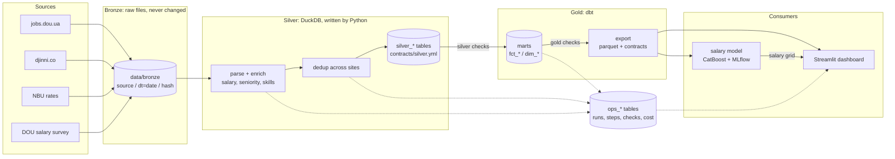

# Architecture

A reader's view of one day: the flow scrapes, parses what is new, runs the silver checks, builds gold with
dbt, runs the gold checks and exports. A failed step skips the steps that need it, so bad data does not
reach the files other people read.

## Layers

- **Bronze** keeps what the sites returned, as files, with a metadata file written last. It never changes,
  so everything downstream can be rebuilt from it without the network (a parser fix, a new skill, a new
  rule).
- **Silver** is cleaned and typed: one row per vacancy, per skill of a vacancy, per exchange rate. It is
  written by Python (parsing, salary and text rules, the skill dictionary, deduplication) with upserts,
  so running a date twice gives the same rows.
- **Gold** is SQL in dbt: the lifecycle of a vacancy, SCD2 history, demand, co-occurrence, salary
  percentiles, with tests and enforced column contracts. It is rebuilt from silver on every run.
- **Ops** tables record every run, step, check and LLM call. Questions about the pipeline are queries.

## How it runs

- GitHub Actions starts `make pipeline` at 04:00 UTC. The flow (`src/jobmarket/flow.py`) runs the steps
  with timeouts, retries for the scraping steps and skipping of dependent steps; each attempt is a row in
  `ops_task_runs`, the whole run a row in `ops_pipeline_runs`.
- Storage between runs is a rolling GitHub Actions cache (bronze and the DuckDB file). It is interim, not
  durable: object storage replaces it (see below).
- The same code runs in a container (`make docker-pipeline`) and on a laptop (`make pipeline`).
- Results: the parquet export is kept as a run artifact, `status.json` describes the run, and an optional
  Telegram message summarises it.

## Why these choices

The reasons and what was rejected are in [decisions.md](decisions.md). The short version: files first
(so everything is reproducible), the simplest tool that is correct (DuckDB, plain Python for the flow),
SQL for the part that is SQL (dbt, with tests), and a number on every claim (checks, SLOs, metrics).

## What it is not

It is not big data: a few thousand vacancies a day, a few hundred megabytes in total. The point is to
apply the practices (idempotency, contracts, checks, observability, backfill) on real, messy data, at a
size where every result can be inspected.

## Not built yet

- **Object storage for bronze** (S3-compatible) and a **Postgres warehouse** for production. The code
  reads bronze through plain paths, and the dbt models use DuckDB functions, so both are separate pieces
  of work, not a configuration change.
- **Hosting** of the dashboard and **monthly retraining**: both need somewhere to keep state between runs.

## If the data were 100 times larger

Said as reasoning, not as something built:

- Bronze is already partitioned by source and day, so it moves to object storage with the same layout and
  the parsers read per partition.
- DuckDB allows one writer. Parsing would run per day in parallel, writing partitions that are merged,
  or silver would move to a table format with concurrent writers (Iceberg or Delta) or a warehouse.
- Deduplication already compares only vacancies of one company, so it stays near-linear; only the
  skill co-occurrence (pairs per vacancy) grows quickly, and it would move to the warehouse engine.
- dbt models stay as they are; they would run on that engine. Orchestration would move from one cron job
  to a scheduler with workers (Airflow or Prefect), once there is more than one pipeline to run.
- What would not change: immutable bronze, idempotent steps, contracts, checks, the ops tables.
